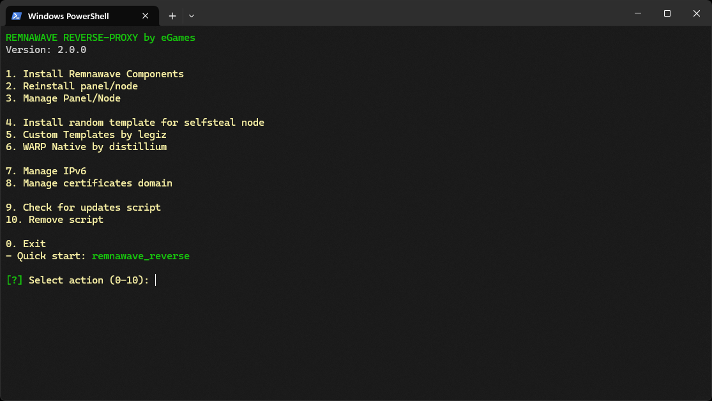

<p aling="center"><a href="https://github.com/LoopAxolotlNeedle/reMNAwAve_revErsE_PRoXY">
 <picture>
   <source media="(prefers-color-scheme: dark)" srcset="./media/logo.png" />
   <source media="(prefers-color-scheme: light)" srcset="./media/logo-black.png" />
   
 </picture>
</a></p>

<p align="center">
   <a href="/README-RU.md">Русский</a> |  <strong>English</strong>
</p>

---

> [!CAUTION]
> **ЭТОТ РЕПОЗИТОРИЙ ЯВЛЯЕТСЯ ОБРАЗОВАТЕЛЬНЫМ ПРИМЕРОМ ДЛЯ ИЗУЧЕНИЯ ОСНОВ NGINX, РЕВЕРС-ПРОКСИ И СЕТЕВОЙ БЕЗОПАСНОСТИ. ЭТОТ СКРИПТ ДЕМОНСТРИРУЕТ НАСТРОЙКУ NGINX В КАЧЕСТВЕ РЕВЕРС-ПРОКСИ. НЕ ДЛЯ ПРОДАКШЕНА И НЕ ДЛЯ ПРОДАКШЕНА! ЕСЛИ ВЫ НЕ ПОНИМАЕТЕ, КАК РАБОТАЕТ ПАНЕЛЬ УПРАВЛЕНИЯ - ЭТО ВАША ПРОБЛЕМА, А НЕ АВТОРА СКРИПТА. ИСПОЛЬЗУЙТЕ НА СВОЙ СТРАХ И РИСК!**

---

## Обзор

Этот скрипт автоматизации упрощает развертывание сервера реверс-прокси с использованием NGINX и XRAY, а также установку панели управления Remnawave и узла. Архитектура оптимизирована для производительности: Xray работает непосредственно на порту 443 и перенаправляет трафик через Unix-сокет, который слушает NGINX, минимизируя накладные расходы TCP и повышая надежность соединения.

> [!IMPORTANT]
> Поддержка Debian и Ubuntu. Скрипт был протестирован в среде виртуализации KVM. Для корректной работы вам потребуется собственный домен. Рекомендуется запускать с правами root на свежеустановленной системе.

### Режимы развертывания

Скрипт поддерживает гибкие конфигурации развертывания:

**1. Режим одного сервера**
- Панель управления и узел XRAY установлены на одной машине
- Подходит для компактных установок с умеренным трафиком

**2. Распределенный режим**
- **Сервер панели**: Центр управления без узла XRAY
- **Сервер узла**: Хостинг узла XRAY с заглушкой SelfSteal для VLESS REALITY

### Требования к домену

Перед установкой подготовьте три домена или поддомена:

1. **Панель управления**: Доступ к интерфейсу управления
2. **Страница подписки**: Распространение конфигураций клиентов
3. **Заглушка SelfSteal**: Камуфляжный веб-сайт, размещенный на сервере узла

---

## Настройка домена

Скрипт поддерживает два метода получения SSL-сертификатов:
- **Cloudflare**: Управление через Cloudflare API
- **ACME**: Прямая интеграция с хостинг-провайдером

### Примеры настройки DNS

#### Установка на одном сервере (панель + узел вместе)

| Тип записи | Имя              | Значение            | Статус прокси |
|------------|-------------------|------------------|--------------|
| A          | example.com       | your_server_ip   | Только DNS     |
| CNAME      | panel.example.com | example.com      | Только DNS     |
| CNAME      | sub.example.com   | example.com      | Только DNS     |
| CNAME      | node.example.com  | example.com      | Только DNS     |

> [!TIP]
> Запись `node.example.com` необязательна для функциональности SelfSteal. Вы можете использовать корневой домен `example.com` вместо нее.

#### Распределенная установка (панель и узел на разных серверах)

| Тип записи | Имя              | Значение                | Статус прокси |
|------------|-------------------|----------------------|--------------|
| A          | example.com       | panel_server_ip      | Только DNS     |
| CNAME      | panel.example.com | example.com          | Только DNS     |
| CNAME      | sub.example.com   | example.com          | Только DNS     |
| A          | node.example.com  | node_server_ip       | Только DNS     |

---

## Руководство по установке

### Развертывание на одном сервере

1. Запустите скрипт установки
2. Выберите **"Установить компоненты Remnawave"**
3. Выберите **"Установить панель и узел на одном сервере"**
4. Дождитесь завершения
5. Скрипт автоматически перезапустит службы и отобразит учетные данные для входа

### Распределенное развертывание

**Шаг 1: Настройка сервера панели**

1. Запустите скрипт установки на первом сервере
2. Выберите **"Установить компоненты Remnawave"**
3. Выберите **"Установить только панель"**
4. Сохраните предоставленные учетные данные

**Шаг 2: Экспорт сертификата**

1. Войдите в панель управления
2. Перейдите в **"Узлы"** → **"Управление"**
3. Выберите целевой узел
4. Найдите поле **"Секретный ключ (SECRET_KEY)"**
5. Скопируйте сертификат, нажав на значок копирования

**Шаг 3: Настройка сервера узла**

1. Запустите скрипт установки на втором сервере
2. Выберите **"Установить компоненты Remnawave"**
3. Выберите **"Установить только узел"**
4. Вставьте сертификат, когда будет предложено
5. Подтвердите сообщение об успешном подключении узла

---

## Функции безопасности

### Защита доступа к панели

Конфигурация NGINX реализует аутентификацию на основе параметров URL для защиты от несанкционированного обнаружения:

**Метод доступа**
```
https://panel.example.com/auth/login?<SECRET_KEY>=<SECRET_KEY>
```

**Как это работает**

1. Параметр URL автоматически устанавливает cookie в браузере
   - Имя cookie: `<SECRET_KEY>`
   - Значение cookie: `<SECRET_KEY>`

2. Требования к доступу:
   - Должен присутствовать действительный cookie
   - URL должен содержать правильный параметр

3. Поведение при сбое доступа:
   - Отсутствие cookie: Пустая страница или ошибка 404
   - Неправильный параметр: Пустая страница или ошибка 404

Этот уровень защиты предотвращает:
- Обнаружение путем сканирования хостов
- Атаки методом перебора путей
- Попытки доступа методом перебора

Панель остается невидимой без правильного параметра аутентификации.

---

## Возможности

### Конфигурация прокси-сервера
- Автоматическое обновление конфигурации через подписку
- Поддержка JSON-подписок с преобразованием формата для популярных клиентов
- Совместимость с основными прокси-клиентами

### Интеграция с NGINX
- Оптимизированная настройка реверс-прокси с XRAY
- Связь через Unix-сокет для снижения накладных расходов

### Реализация безопасности
- **Брандмауэр**: Конфигурация UFW для контроля доступа
- **SSL-сертификаты**: Cloudflare или ACME с автоматическим обновлением
- **Управление IPv6**: Меры по предотвращению уязвимостей
- **Оптимизация TCP**: Алгоритм управления перегрузкой BBR
- **Маскировка**: Случайный выбор шаблона веб-сайта

---

## Быстрый старт

Выполните следующую команду, чтобы начать установку:
```bash
bash <(curl -Ls https://raw.githubusercontent.com/LoopAxolotlNeedle/reMNAwAve_revErsE_PRoXY/refs/heads/main/install_remnawave.sh)
```

Если GitHub недоступен, используйте зеркало jsDelivr:
```bash
bash <(curl -Ls https://cdn.jsdelivr.net/gh/LoopAxolotlNeedle/reMNAwAve_revErsE_PRoXY@main/install_remnawave.sh)
```

<p align="center">
  
</p>

---

> [!CAUTION]
> **Данный репозиторий предназначен исключительно для образовательных целей и изучения принципов работы реверс-прокси серверов и сетевой безопасности. Скрипт демонстрирует настройку прокси-сервера с использованием NGINX для реверсивного проксирования, управления трафиком и защиты от атак.**
>
> **Мы настоятельно напоминаем вам, что использование данного инструмента для обхода сетевых блокировок или цензуры является незаконным в ряде стран, где существуют законы, регулирующие использование технологий для обхода ограничений интернета.**
>
> **Данный проект не предназначен для использования способами, нарушающими законы о защите информации или вмешивающимися в механизмы цензуры. Мы не несем ответственности за какие-либо юридические последствия, связанные с использованием данного скрипта.**
>
> **Используйте данный инструмент/скрипт исключительно в демонстрационных целях, как пример работы реверс-прокси и защиты данных. Настоятельно рекомендуем удалить скрипт после ознакомления. Дальнейшее использование осуществляется на ваш собственный риск.**
>
> **Если вы не уверены, нарушает ли использование данного инструмента или его компонентов законы вашей страны - воздержитесь от любого взаимодействия с данным инструментом.**

## Сообщество

Присоединяйтесь к нашему сообществу в Telegram для поддержки и обсуждений:

**Telegram чат**: [https://t.me/remnawave_reverse](https://t.me/remnawave_reverse)

## Пожертвования

Если вам нравится этот проект и вы хотите поддержать его дальнейшее развитие, пожалуйста, рассмотрите возможность сделать пожертвование. Ваш вклад помогает финансировать будущие обновления и улучшения!

**Способы пожертвования:**

- **TON USDT:** `UQAxyZDwKUPQ5Bp09JOFcaDVakjYQT46rf3iP3lnl_qc9xVS`